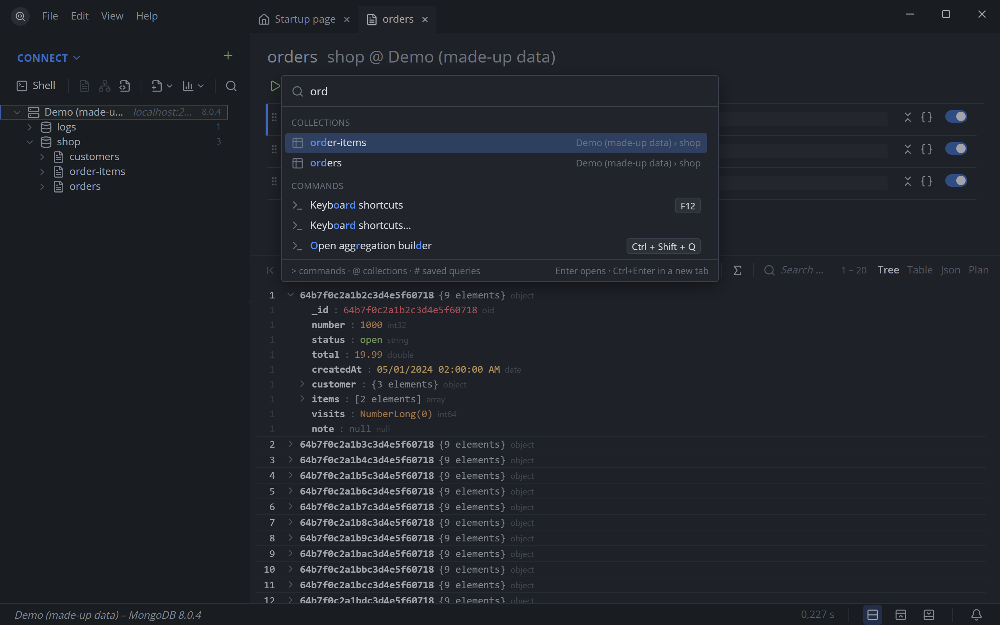

<div align="center">


# QueryMaster

**The MongoDB client that thinks one step ahead.**


[](LICENSE.md)

<br>

<picture>
  <source media="(prefers-color-scheme: light)" srcset="sources/homepage/public/screenshots/light.png">
  
</picture>

</div>

QueryMaster is a desktop client for MongoDB. It suggests the values in your collections while you type,
shows slow queries as a plan with a hint where an index helps, and asks before anything is written on a
production server. It talks to MongoDB through the official Rust driver, keeps its own data in SQLite and
the passwords in the keychain of the operating system.

<table>
<tr>
<td width="50%"><br><sub><b>Suggestions from your data</b> – the values of a field, with how often they occur</sub></td>
<td width="50%"><br><sub><b>Explain as a plan</b> – stages, time per stage and what index is missing</sub></td>
</tr>
<tr>
<td><br><sub><b>Command palette</b> – collections, saved queries, commands and connections</sub></td>
<td><br><sub><b>Tree, table or JSON</b> – edit in place, filter by a value, export and import</sub></td>
</tr>
</table>

**And also:** aggregation and SQL builders · schema analysis · JavaScript scripts in the shell · saved
queries and session restore · protection for production · users, roles, server status and log · five
themes · English and German.

## Table of Contents

1. [Prerequisites](#prerequisites)
2. [Setup for Development](#setup-for-development)
3. [Homepage](#homepage)
4. [Releases](#releases)
5. [Contributing](#contributing)
6. [License](#license)

---

## Prerequisites

Before you begin, ensure you have the following installed:

1. [Rust](https://www.rust-lang.org/learn/get-started)
2. [Tauri system dependencies](https://v2.tauri.app/start/prerequisites/#system-dependencies) for your platform
3. [Mise](https://mise.jdx.dev)

---

## Setup for Development

To get your development environment set up, follow these steps:

1. **Clone the repository**
   Clone the repository and enter the app directory:

    ```bash
    git clone https://github.com/LeonSnajdr/query-master.git
    cd query-master/sources/app
    ```

2. **Install dependencies**
   Install the development tools (Node, Bun, sqlx-cli) and the frontend packages:

    ```bash
    mise install
    bun install
    ```

3. **Setup backend**
   Create the development database, run migrations, and prepare query metadata:

    ```bash
    cd src-tauri
    cargo sqlx database create
    cargo sqlx migrate run
    cargo sqlx prepare -- --tests
    cd ..
    ```

4. **Run QueryMaster**

    ```bash
    bun run app:dev
    ```

    `bun run dev` alone opens the interface in a browser with made-up data (`src/api.mock.ts`):
    `http://localhost:1420/?demo` opens a collection of it right away, `?session` starts with a last
    session to restore.

### Checks

All commands run in `sources/app`.

| What | Command |
| --- | --- |
| Lint | `bun run lint` |
| Types | `bun run type-check` |
| Unit tests | `bun run test` |
| Spelling of the interface texts | `bun run cspell` |
| Rust format and Clippy | `bun run rust:check` |
| Rust tests | `bun run rust:test` |
| Migrate, prepare, format, lint and test the Rust side | `pwsh tools/check-rust.ps1` |
| The app against a real server | `bun run e2e` (`e2e:release` for the built program) |
| Installers without updater artifacts | `bun run app:build` |

The tests against a real server use the server in `QUERYMASTER_TEST_URI` (from `.env.local`, default
`mongodb://localhost:27017`); they write only into the database `querymaster_test`:

```bash
cargo test --manifest-path src-tauri/Cargo.toml -- --include-ignored
```

### How it is put together

- `src/shell` – the shell language. `parse.ts` reads statements (they are read, never executed as
  code), `plan.ts` turns them into database commands, `context.ts` and `complete.ts` find what to
  suggest at the cursor, `catalog.ts` lists methods, stages and operators with the server version
  that brought them.
- `src/shell/runtime` – what a script sees (`db`, BSON helpers, `print`). `bun run build:runtime`
  bundles it into `src-tauri/script/runtime.js`, which the Rust side embeds and runs in QuickJS
  (`src-tauri/src/script`). Rebuild and commit the bundle after changing the runtime or `plan.ts`.
- `src-tauri/src` – the two commands that run a database command (`mongo.rs`), the local SQLite
  database (`db`, tables in `src-tauri/migrations`, rules in
  [`docs/roadmap/11-ablage.md`](sources/app/docs/roadmap/11-ablage.md)) and the saved connections in it
  (`connection`; their connection strings live in the keychain of the operating system).
- `i18n/locales` – every text of the interface, English and German, as flat keys, added with
  `bun tools/locale.ts`. `i18n/locales.test.ts` keeps both languages and the catalog in step.
- `docs/roadmap` – the plans per stage and what is still open.

---

## Homepage

The product page is a project of its own in `sources/homepage` (Vite and Vue, built into static files):

```bash
cd sources/homepage
mise install
bun install
bun run dev
```

`bun run build` writes the site to `dist`; it uses relative paths and runs from any folder of a web
server. The screenshots in `public/screenshots` are also those of this README. They are taken from the
browser preview of the app with its made-up data: run `bun run dev` in `sources/app`, then
`node tools/screenshots.mjs` there (it needs Microsoft Edge).

---

## Releases

Every push to `main` builds QueryMaster for Windows, macOS and Linux
([`.github/workflows/release.yml`](.github/workflows/release.yml)). The version is the date and the
number of the run, for example `26.10.12`; it becomes the tag and the GitHub release with the installers
and a signed `latest.json`. The installed app looks for a newer release when it starts and offers it;
*Help → About QueryMaster → Check for updates* asks at any time.

Once, before the first release, the updates need a key pair:

```bash
bun run tauri signer generate -w ~/.tauri/querymaster.key
```

Put the public key into `plugins.updater.pubkey` in `sources/app/src-tauri/tauri.conf.json`, and the
private key and its password into the repository secrets `TAURI_SIGNING_PRIVATE_KEY` and
`TAURI_SIGNING_PRIVATE_KEY_PASSWORD`. The actions in the workflows are pinned to commits that are at least
14 days old ([pinact](https://github.com/suzuki-shunsuke/pinact), `.github/pinact.yaml`).

---

## Contributing

Contributions are welcome! Feel free to open an issue or submit a pull request. I appreciate all feedback
and suggestions to improve the project.

---

## License

This project is licensed under the [Prosperity Public License 3.0.0](LICENSE.md): free for noncommercial
use – personal, hobby, study, charities, schools and public institutions – and a thirty-day trial for
commercial use. Feel free to browse and contribute to the codebase under these guidelines.
