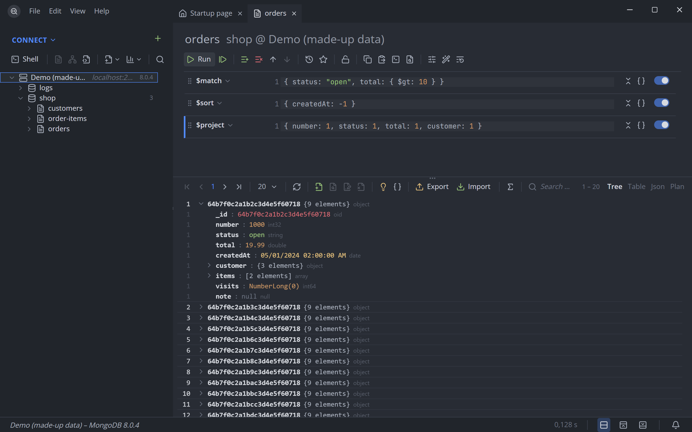
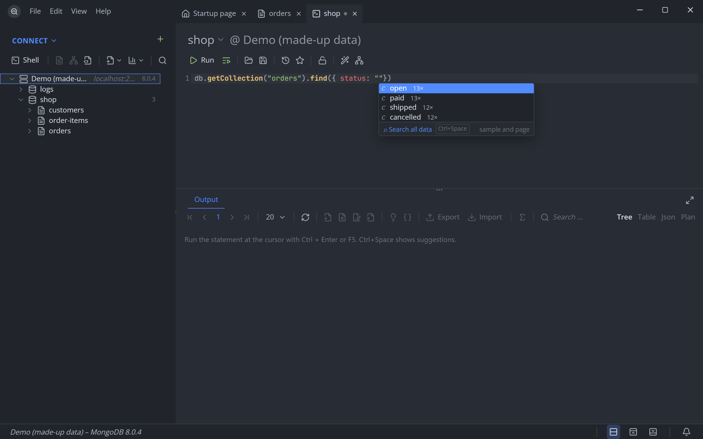
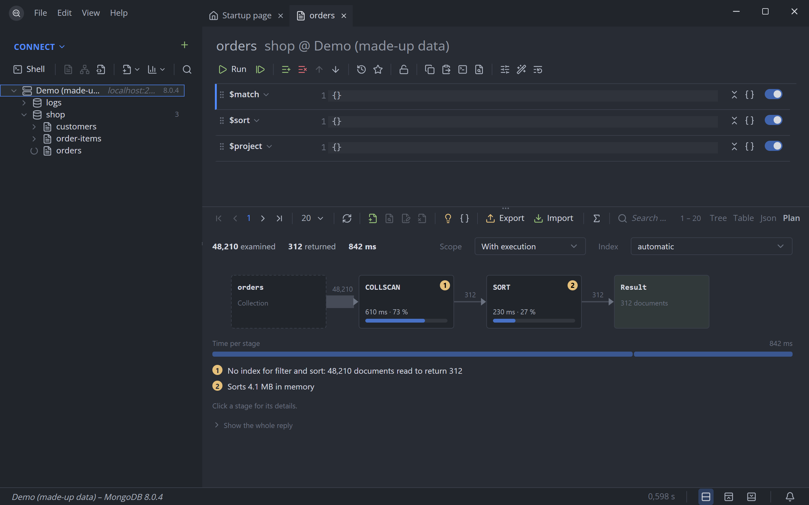
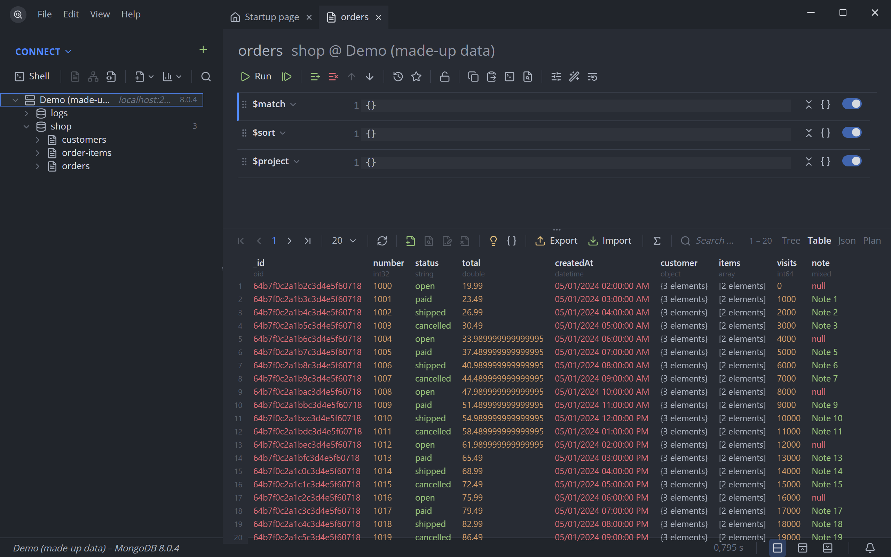
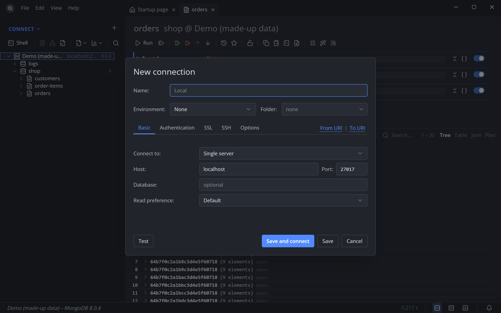
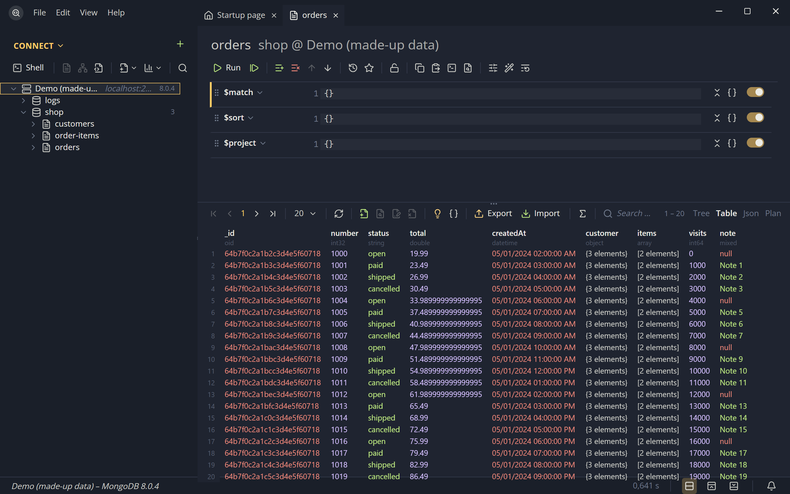

<div align="center">


# QueryMaster

**The MongoDB client that thinks one step ahead.**

Write queries with suggestions from your real data, see why they are slow, and keep production safe.
Native, fast and keyboard-first.


[](LICENSE.md)

<br>

<picture>
  <source media="(prefers-color-scheme: light)" srcset="docs/screenshots/light.png">
  
</picture>

<sub>All screenshots show the browser preview with made-up data.</sub>

</div>

---

## Features

<table>
<tr>
<td width="50%" valign="top">

### Suggestions from your data

The editor knows methods, stages and operators, with the server version that brought them – and
the values in your collections. Type `status: "` and pick from what is actually there.
`Ctrl+Space` a second time searches all data.

</td>
<td width="50%"></td>
</tr>
<tr>
<td></td>
<td valign="top">

### Explain, as a picture

Source → stages → result, with documents and time per stage. Hints name the problem
(*no index for filter and sort*) and offer to create the index or force another one.

</td>
</tr>
<tr>
<td valign="top">

### Command palette

`Ctrl+Shift+P` reaches every collection, saved query, command and connection. Every shortcut can
be rebound in the settings, with a check for conflicts.

</td>
<td></td>
</tr>
<tr>
<td></td>
<td valign="top">

### Tree, table or JSON

Edit values in place, with suggestions. *Filter by this value* from the context menu. Export to
JSON, CSV, SQL in four dialects or straight into another database; import JSON and CSV.

</td>
</tr>
</table>

**And also:** aggregation and SQL builders · schema analysis with *Use as validator* · real
JavaScript scripts in the shell · saved queries and session restore · protection for production
(red status bar, confirmation with count and preview) · folders, colours, notes and read-only marks
in the tree · users, roles, server status and log · five themes.

<details>
<summary><b>More screenshots</b></summary>
<br>

| New connection | Ayu Mirage |
|---|---|
|  |  |

</details>

## Get started

You need [Bun](https://bun.sh), [Rust](https://rustup.rs) and the
[Tauri prerequisites](https://tauri.app/start/prerequisites/) of your system.

```bash
bun install
```

```bash
bun run app:dev
```

`bun run dev` alone opens the interface in a browser with made-up data (`src/api.mock.ts`):
`http://localhost:1420/?demo` opens a collection of it right away, `?session` starts with a last
session to restore (one of its connections can not be reached).

Build the installers (MSI and NSIS on Windows):

```bash
bun run app:build
```

## Checks

| What | Command |
|---|---|
| Lint | `bun run lint` |
| Types | `bun run type-check` |
| Unit tests | `bun run test` |
| Rust format, Clippy | `bun run rust:check` |
| Rust tests | `bun run rust:test` |
| The app against a real server | `bun run e2e` (`e2e:release` for the built program) |
| Screenshots in `docs/screenshots` | `node tools/screenshots.mjs` (with `bun run dev` running) |

### Against a real server

```bash
cargo test --manifest-path src-tauri/Cargo.toml -- --include-ignored
```

The ignored tests and `bun run e2e` use the server in `QUERYMASTER_TEST_URI` (from `.env.local`,
default `mongodb://localhost:27017`); they write only into the database `querymaster_test`.

## How it is put together

```text
src/shell           the shell language: parse (read, never executed), plan, complete, catalog
src/shell/runtime   what a script sees (db, BSON helpers, print), bundled for QuickJS
src/components      the interface (Vue 3, Vuetify0, UnoCSS)
src-tauri/src       Rust: database commands (mongo.rs), SQLite storage, saved connections, scripts
i18n/locales        every text of the interface, English and German
docs/roadmap        plans per stage, with mockups
```

- `src/shell` – `parse.ts` reads statements, `plan.ts` turns them into database commands,
  `context.ts` and `complete.ts` find what to suggest at the cursor, `catalog.ts` lists methods,
  stages and operators with the server version that brought them.
- `src/shell/runtime` – `bun run build:runtime` bundles it into `src-tauri/script/runtime.js`,
  which the Rust side embeds and runs in QuickJS (`src-tauri/src/script`). Rebuild and commit the
  bundle after changing the runtime or `plan.ts`.
- `src-tauri/src` – the two commands that run a database command (`mongo.rs`), the local SQLite
  database (`db`, tables in `src-tauri/migrations`) and the saved connections in it (`connection`;
  their connection strings live in the keychain of the operating system).
- `i18n/locales` – flat keys. Descriptions of completion entries are `doc.<group>.<name>`; errors
  of the Rust side arrive as keys too (`error.backend.*`). `i18n/locales.test.ts` keeps both
  languages and the catalog in step. New texts are added with `bun tools/locale.ts`.

### Local database

What the app stores lies in SQLite through sqlx. Queries are checked at compile time against
`src-tauri/dev.db` (`DATABASE_URL` in `src-tauri/.env`) or, without it, against the cache in
`src-tauri/.sqlx`. After adding a migration or changing a query, in `src-tauri`:

```bash
sqlx migrate run
```

```bash
cargo sqlx prepare -- --tests
```

`tools/check-rust.ps1` does both and then formats, lints and tests, each step with a time limit.
`sqlx` is `cargo install sqlx-cli`. Rules for new tables: [`docs/roadmap/11-ablage.md`](docs/roadmap/11-ablage.md).

## Not there yet

SSH tunnels, change streams, the *Text* tab of the shell. Map Reduce and server-side functions are
deprecated by MongoDB and stay out. The full state per stage is in the
[roadmap](docs/roadmap/README.md).

## License

QueryMaster is licensed under the [Prosperity Public License 3.0.0](LICENSE.md): free for
noncommercial use – personal, hobby, study, charities, schools and public institutions – and a
thirty-day trial for commercial use. Contributions back under a standard open-source license do
not count as commercial use.
